<p align="center">
  
</p>

<h1 align="center">Nurul Faiyaz · Portfolio</h1>

<p align="center">
  <strong>An early chapter in a motion-led digital identity.</strong><br/>
  A lightweight single-page portfolio built with HTML, Tailwind CSS and GSAP for responsive layout and scroll-driven motion.
</p>

<p align="center">
  <a href="https://developer.mozilla.org/en-US/docs/Web/HTML"></a>
  <a href="https://tailwindcss.com/"></a>
  <a href="https://gsap.com/"></a>
</p>

<p align="center">
  <a href="#project-details">Overview</a> · <a href="#project-setup">Get started</a> · <a href="#creator-developer-maintainer">Creator</a>
</p>

---

<a id="project-details"></a>
## Overview

This repository contains a single-page portfolio built with HTML, Tailwind CSS loaded from its CDN, and GSAP/ScrollTrigger for motion and scrolling effects. The source is intentionally lightweight and does not require a Node.js build step.

## Technology

| Layer | Technology |
|---|---|
| Structure | HTML5 |
| Styling | Tailwind CSS CDN and custom CSS |
| Motion | GSAP 3.12.5 and ScrollTrigger |
| Typography | Google Fonts |
| Icons | Font Awesome CDN |

<a id="project-setup"></a>
## Run locally

1. Clone the repository:

   ```bash
   git clone https://github.com/tracolerd/Faiyaz-s-Portfolio.git
   cd Faiyaz-s-Portfolio
   ```

2. Open `index.html` in a browser, or serve the folder with any static web server.

The page loads several front-end assets from CDNs, so an internet connection is required for those resources. No `npm install` step is needed for the current static implementation.

## Project structure

```text
.
├── index.html
└── LICENSE
```

## Status and scope

This is a front-end portfolio website, not a backend service. Deployment can use any static hosting provider that serves `index.html` and its external assets. Validate responsive behavior and external CDN availability before relying on a production deployment.


---
---

---

## Creator, Developer & Maintainer

**Created, designed, developed, documented, and maintained by [Nurul Faiyaz](https://github.com/tracolerd).**

Designed, implemented, documented, and maintained independently by Nurul Faiyaz.

<p align="center">
  <a href="https://www.facebook.com/faiyaz.888"></a>
  <a href="https://www.instagram.com/tracolerd"></a>
  <a href="https://www.linkedin.com/in/faiyaz-xyz"></a>
  <a href="https://x.com/faiyaz_explores"></a>
  <a href="https://github.com/tracolerd"></a>
  <a href="mailto:scrollfaiyaz@gmail.com"></a>
  <a href="https://nurul-faiyaz.netlify.app/"></a>
</p>

<p align="center">
  <a href="https://www.facebook.com/faiyaz.888">Facebook</a> ·
  <a href="https://www.instagram.com/tracolerd">Instagram</a> ·
  <a href="https://www.linkedin.com/in/faiyaz-xyz">LinkedIn</a> ·
  <a href="https://x.com/faiyaz_explores">X / Twitter</a> ·
  <a href="https://github.com/tracolerd">GitHub</a> ·
  <a href="mailto:scrollfaiyaz@gmail.com">Email</a> ·
  <a href="https://nurul-faiyaz.netlify.app/">Website</a>
</p>

## License

See [LICENSE](LICENSE) for the license terms.

---

<p align="center"><sub>Portfolio catalog · Project 22 of 22 · <a href="https://github.com/tracolerd">Nurul Faiyaz</a></sub></p>
